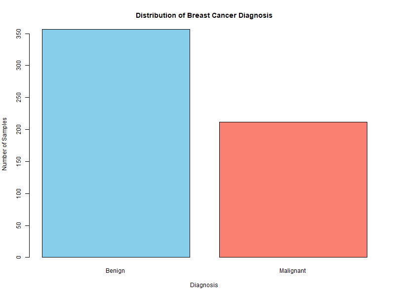
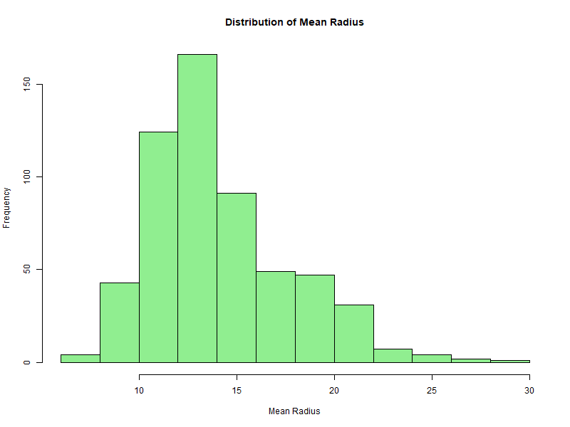
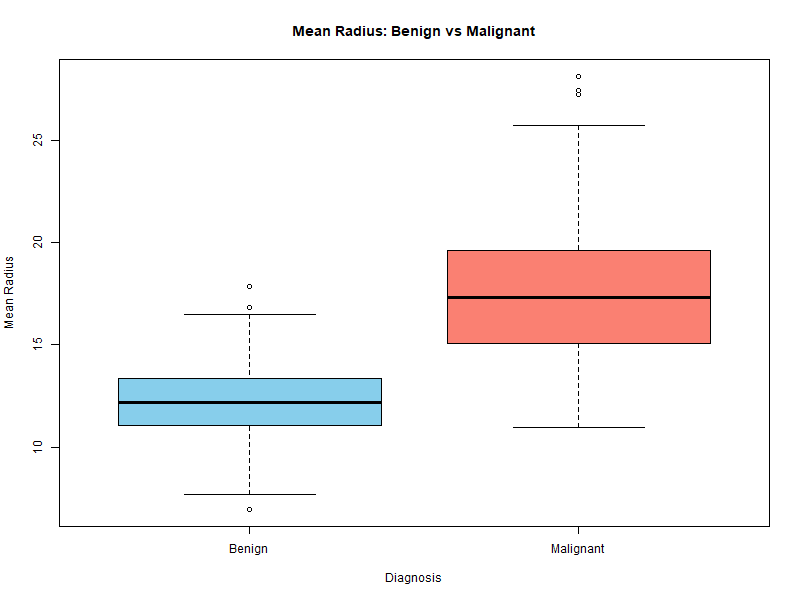
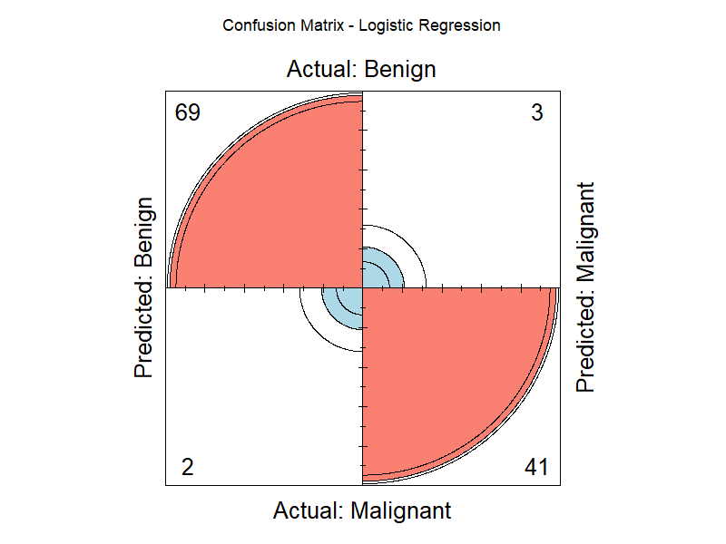
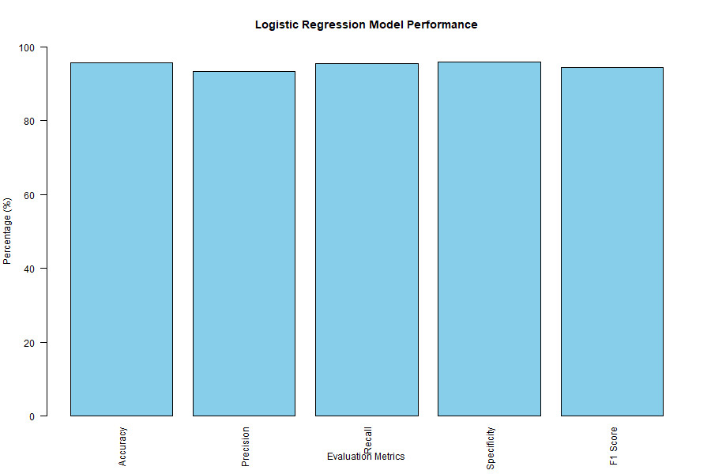

# Breast Cancer Classification Using Machine Learning

**Author:** Keerthana Rasaiah  
**Degree:** BSc (Hons) Information Technology  
**University:** University of Vavuniya, Sri Lanka

## 1. Project Overview

Breast cancer is one of the most common types of cancer affecting women worldwide. Early detection and accurate diagnosis are important for improving treatment outcomes. Breast tumours are generally classified into two categories: Benign and Malignant.

Machine learning techniques can help analyse medical datasets and identify patterns in numerical data. Classification algorithms can learn from labelled examples and predict the category of new observations.

This project focuses on developing a machine learning classification model to classify breast tumour samples as Benign or Malignant using the Breast Cancer Wisconsin (Diagnostic) dataset. The project uses the R programming language for data preprocessing, exploratory data analysis, model development and evaluation.

Logistic Regression is used as the classification algorithm. The model uses selected numerical characteristics of cell nuclei to predict the diagnosis.

## 2. Research Problem

Accurately distinguishing between benign and malignant breast tumours is an important task in medical diagnosis. Medical datasets contain several numerical measurements describing tumour cell characteristics.

Analysing these measurements manually can be challenging. Machine learning techniques can be investigated to identify useful patterns in the data and support the classification process.

This project investigates whether selected tumour characteristics can be used to classify breast tumour samples into Benign and Malignant categories.

## 3. Research Question

Can a machine learning model classify breast tumour samples as Benign or Malignant using numerical characteristics of cell nuclei?

## 4. Project Objectives

The main objectives are:

- To obtain a publicly available breast cancer diagnostic dataset.
- To import and preprocess the dataset using R.
- To explore the dataset using statistical summaries and visualizations.
- To develop a Logistic Regression classification model.
- To evaluate the model using appropriate classification metrics.
- To interpret the results and identify the limitations of the model.

## 5. Dataset Description

This project uses the Breast Cancer Wisconsin (Diagnostic) dataset from the UCI Machine Learning Repository.

The dataset contains 569 breast tumour samples and 30 numerical features. Each sample is labelled as either Benign or Malignant.

The dataset contains:

| Description | Value |
|---|---:|
| Total observations | 569 |
| Numerical features | 30 |
| Benign samples | 357 |
| Malignant samples | 212 |
| Target variable | Diagnosis |

The numerical features describe characteristics of cell nuclei, including radius, texture, perimeter, area, smoothness, compactness, concavity, concave points, symmetry and fractal dimension.

For each characteristic, three measurements are available: mean, standard error (SE) and worst value.

The original ID column was removed during preprocessing because it does not provide useful information for classification.

**Dataset source:**  
https://archive.ics.uci.edu/dataset/17/breast+cancer+wisconsin+diagnostic

## 6. Tools and Technologies

The following tools and technologies were used:

- **R:** Programming language used for data analysis and machine learning.
- **RStudio:** Development environment for writing and executing R scripts.
- **UCI Machine Learning Repository:** Source of the public dataset.
- **Base R:** Used for data import, preprocessing, statistical analysis and visualizations.
- **Logistic Regression:** Classification algorithm used to predict tumour diagnosis.
- **Git and GitHub:** Used for version control and project hosting.
- **R Markdown:** Used to prepare the final HTML report.

## 7. Data Preprocessing

The dataset was downloaded from the UCI Machine Learning Repository and imported into R using the `read.csv()` function.

Appropriate column names were assigned to the dataset to make the variables easier to understand. The ID column was removed, and the diagnosis variable was converted into a factor with two categories: Benign and Malignant.

Missing values and duplicate records were checked. The analysis identified zero missing values and zero duplicate records.

After preprocessing, the cleaned dataset contained 569 observations and 31 columns, including 30 numerical features and one diagnosis variable.

The cleaned dataset was saved as a CSV file for subsequent analysis.

## 8. Exploratory Data Analysis

Exploratory Data Analysis (EDA) was performed to understand the distribution of diagnosis categories and the numerical characteristics of the dataset.

### 8.1 Diagnosis Distribution

A bar chart was created to display the number of Benign and Malignant samples. The dataset contains 357 Benign samples and 212 Malignant samples.



### 8.2 Mean Radius Distribution

A histogram was created to examine the distribution of the mean radius feature across all tumour samples.



### 8.3 Mean Radius Comparison

A boxplot was created to compare mean radius values between Benign and Malignant tumour samples. This visualization helps examine differences in the distribution of the feature between the two diagnosis categories.



These visualizations provide an initial understanding of the dataset and the differences between the diagnosis categories.

## 9. Machine Learning Model Development

### 9.1 Selected Algorithm

Logistic Regression was selected as the classification algorithm. It is a statistical method used to estimate the probability of an observation belonging to a particular category.

In this project, the model predicts whether a tumour sample is Benign or Malignant.

### 9.2 Feature Selection

Four numerical features were selected as predictors:

- Mean Radius
- Mean Texture
- Mean Smoothness
- Mean Concavity

The diagnosis variable was used as the target variable.

### 9.3 Training and Testing

The dataset was divided into training and testing sets using an 80:20 ratio. Stratified sampling was used to maintain the diagnosis class distribution in both sets.

The random seed was set to 123 to make the splitting process reproducible.

| Dataset | Number of samples |
|---|---:|
| Training dataset | 454 |
| Testing dataset | 115 |
| Total | 569 |

The Logistic Regression model was trained using the `glm()` function in R with the binomial family.

The trained model was saved as an RDS file for reuse during model evaluation.

## 10. Model Evaluation

The trained model was evaluated using the testing dataset. Predicted probabilities were converted into Benign or Malignant predictions using a threshold of 0.5.

A confusion matrix was generated to compare the actual diagnosis with the predicted diagnosis.

### 10.1 Confusion Matrix

| Actual Diagnosis | Predicted Benign | Predicted Malignant |
|---|---:|---:|
| Benign | 69 | 3 |
| Malignant | 2 | 41 |

The model correctly classified 69 Benign samples and 41 Malignant samples.

It incorrectly classified 3 Benign samples as Malignant and 2 Malignant samples as Benign.



### 10.2 Performance Metrics

The model was evaluated using five classification metrics.

| Metric | Result |
|---|---:|
| Accuracy | 95.65% |
| Precision | 93.18% |
| Recall | 95.35% |
| Specificity | 95.83% |
| F1-Score | 94.25% |

**Accuracy:** The proportion of all predictions that were correct.

**Precision:** The proportion of samples predicted as Malignant that were actually Malignant.

**Recall:** The proportion of actual Malignant samples correctly identified by the model.

**Specificity:** The proportion of actual Benign samples correctly identified by the model.

**F1-Score:** The harmonic mean of precision and recall.

### 10.3 Performance Visualization

A bar chart was created to compare the five evaluation metrics.



## 11. Results and Discussion

The Logistic Regression model achieved an accuracy of 95.65% on the testing dataset. This indicates that the model correctly classified most of the test samples.

The precision was 93.18%, showing that most samples predicted as Malignant were actually Malignant.

The recall was 95.35%. This indicates that the model correctly identified most of the actual Malignant samples. Recall is particularly important in this classification task because incorrectly classifying a malignant sample as benign may be a serious error.

The specificity was 95.83%, indicating that most Benign samples were correctly identified.

The F1-score was 94.25%, showing a good balance between precision and recall.

According to the confusion matrix, 110 out of 115 test samples were correctly classified. However, five samples were incorrectly classified.

These results demonstrate that the selected numerical features contain useful information for distinguishing between Benign and Malignant samples in this dataset.

However, the results are based on one train-test split of a single public dataset. Further validation is required before drawing broader conclusions about the model's performance.

## 12. Limitations

This project has several limitations.

First, the model was developed using only one publicly available dataset. Its performance may differ when applied to other datasets or populations.

Second, only four numerical features were selected for the Logistic Regression model. Other features may also contain useful information that could improve classification performance.

Third, the evaluation was conducted using a single 80:20 train-test split. Cross-validation and additional testing could provide a more reliable assessment.

Finally, this is an academic machine learning project. It is not a clinically validated diagnostic system and must not be used to make real medical decisions.

## 13. Conclusion

This project investigated the use of machine learning to classify breast tumour samples as Benign or Malignant using the Breast Cancer Wisconsin (Diagnostic) dataset.

The dataset was imported, cleaned and explored using R. Exploratory Data Analysis was conducted using bar charts, histograms and boxplots.

A Logistic Regression model was developed using mean radius, mean texture, mean smoothness and mean concavity as predictor variables.

The model achieved 95.65% accuracy, 93.18% precision, 95.35% recall, 95.83% specificity and a 94.25% F1-score on the testing dataset.

Overall, the results demonstrate that Logistic Regression can classify the samples in this dataset with good performance. Future work could investigate additional machine learning algorithms, more features and cross-validation to improve the reliability of the analysis.

## 14. Project Structure

```text
BreastCancer_Project/
│
├── code/
│   ├── 01_data_import.R
│   ├── 02_download_dataset.R
│   ├── 03_data_import.R
│   ├── 04_data_cleaning.R
│   ├── 05_exploratory_analysis.R
│   ├── 06_eda_summary.R
│   ├── 07_model_training.R
│   ├── 08_model_evaluation.R
│   └── 09_results_visualization.R
│
├── data/
│   ├── wdbc.data
│   └── breast_cancer_clean.csv
│
├── results/
│   ├── figures/
│   ├── eda_group_summary.csv
│   ├── model_evaluation.csv
│   ├── confusion_matrix.csv
│   └── logistic_regression_model.rds
│
├── report/
│   ├── Final_Report.Rmd
│   └── Final_Report.html
│
└── README.md
```

*Note: The structure above describes the main project files. Keep the actual filenames consistent with the files in the repository.*

## 15. How to Run the Project

1. Install R and RStudio.
2. Clone or download this GitHub repository.
3. Open the project in RStudio.
4. Set the project folder as the working directory.
5. Run the R scripts in the appropriate order.
6. The dataset can be downloaded using the download script.
7. Run the data cleaning and EDA scripts.
8. Run the Logistic Regression training and evaluation scripts.
9. Check the generated CSV files and visualizations inside the `results/` folder.
10. Open `report/Final_Report.Rmd` and click Knit to generate the HTML report.

The analysis uses a fixed random seed to make the training and testing split reproducible.

## 16. References

1. Wolberg, W. H., Street, W. N., and Mangasarian, O. L. (1995). Breast Cancer Wisconsin (Diagnostic) Dataset. UCI Machine Learning Repository. https://doi.org/10.24432/C5DW2B
2. UCI Machine Learning Repository. Breast Cancer Wisconsin (Diagnostic) Dataset. https://archive.ics.uci.edu/dataset/17/breast+cancer+wisconsin+diagnostic
3. R Core Team. R: A Language and Environment for Statistical Computing. https://www.r-project.org/
4. Hosmer, D. W., Lemeshow, S., and Sturdivant, R. X. (2013). Applied Logistic Regression. 3rd Edition. Wiley.

## 17. Author

**Keerthana Rasaiah**  
BSc (Hons) Information Technology Undergraduate  
University of Vavuniya, Sri Lanka

**Project:** Breast Cancer Classification Using Machine Learning
