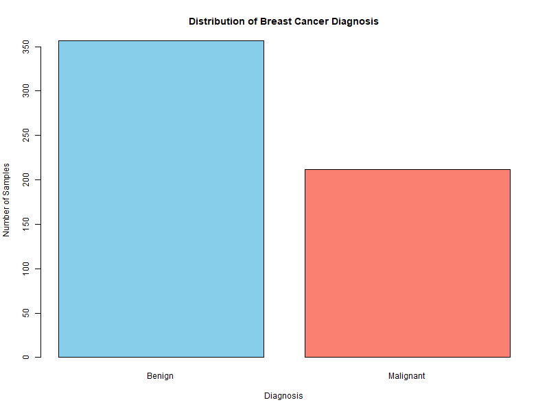
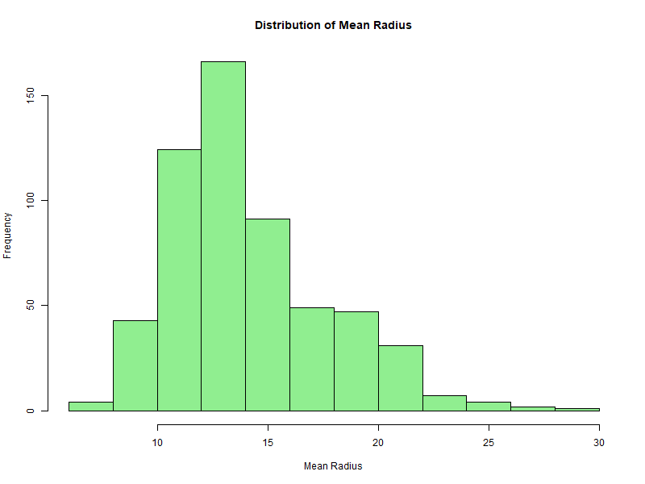
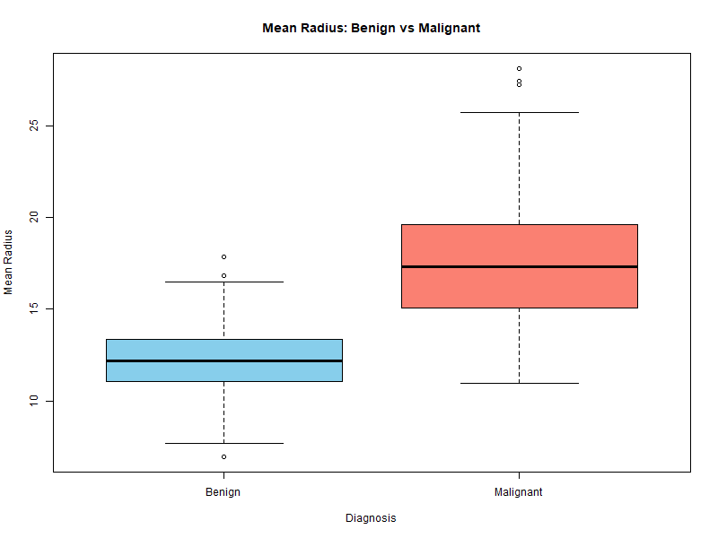
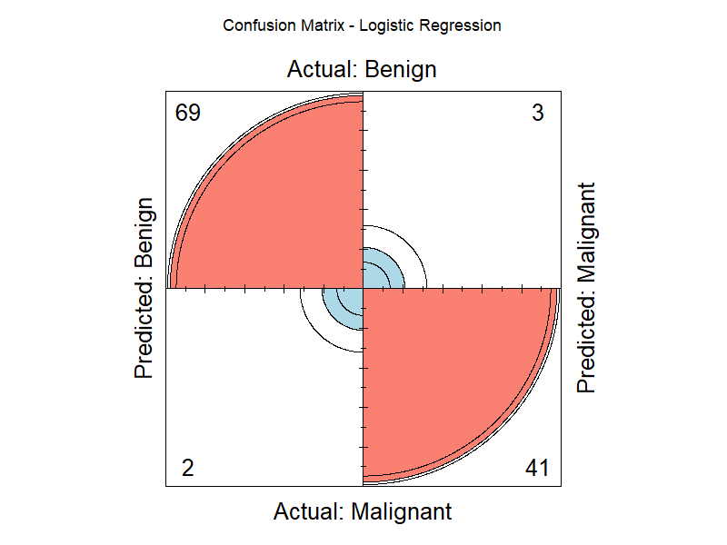
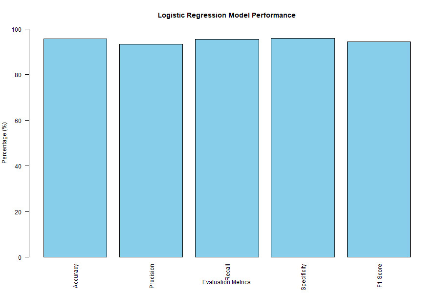

---
title: "Breast Cancer Classification Using Machine Learning"
author: "Keerthana Rasaiah"
date: "2026-11-16"
output:
  html_document:
    toc: true
    toc_depth: 3
    number_sections: false
---

```{r setup, include=FALSE}
knitr::opts_chunk$set(
  echo = FALSE,
  warning = FALSE,
  message = FALSE
)
```

# 1. Introduction

Breast cancer is one of the most common types of cancer affecting women worldwide. Early detection and accurate diagnosis are important for improving treatment outcomes. Breast tumours are generally classified into two main categories: Benign and Malignant. Benign tumours are non-cancerous, whereas malignant tumours are cancerous and may spread to other parts of the body.

Machine learning is a useful approach for analysing medical datasets and identifying patterns in numerical information. Classification algorithms can learn from existing labelled data and predict the category of new samples.

This project focuses on developing a machine learning classification model to classify breast tumour samples as Benign or Malignant. The analysis is conducted using the R programming language and the Breast Cancer Wisconsin (Diagnostic) dataset.

Logistic Regression is used as the classification algorithm. The model uses selected numerical characteristics of cell nuclei to predict the diagnosis.

# 2. Research Problem

Accurately distinguishing between benign and malignant breast tumours is an important task in medical diagnosis. Medical datasets contain several numerical measurements that describe the characteristics of tumour cells.

Analysing these measurements manually can be challenging. Therefore, machine learning techniques can be investigated to identify patterns in the data and support the classification process.

This project addresses the problem of classifying breast tumour samples using numerical features extracted from digitized images of fine needle aspirates of breast masses.

# 3. Research Question

Can a machine learning model classify breast tumour samples as Benign or Malignant using numerical characteristics of cell nuclei?

# 4. Research Objectives

The main objectives of this project are:

- To obtain a publicly available breast cancer diagnostic dataset.
- To import and preprocess the dataset using R.
- To explore the dataset using statistical summaries and visualizations.
- To develop a Logistic Regression classification model.
- To evaluate the model using accuracy, precision, recall, specificity and F1-score.
- To interpret the results and identify the limitations of the model.

# 5. Dataset Description

This project uses the Breast Cancer Wisconsin (Diagnostic) dataset from the UCI Machine Learning Repository.

The dataset contains 569 breast tumour samples and 30 numerical features. Each sample is classified into one of two diagnosis categories: Benign or Malignant.

The dataset contains:

- 357 Benign samples.
- 212 Malignant samples.
- 30 numerical predictor features.
- One diagnosis variable.

The numerical features describe characteristics of cell nuclei, including:

- Radius
- Texture
- Perimeter
- Area
- Smoothness
- Compactness
- Concavity
- Concave points
- Symmetry
- Fractal dimension

For each characteristic, three measurements are available: mean, standard error (SE), and worst value.

The original dataset also contains an ID column, which is not used as a predictor in this project.

**Dataset source:**  
https://archive.ics.uci.edu/dataset/17/breast+cancer+wisconsin+diagnostic

# 6. Data Preprocessing

Data preprocessing was performed before conducting exploratory data analysis and machine learning.

First, the dataset was downloaded from the UCI Machine Learning Repository and imported into R using the `read.csv()` function.

Appropriate column names were assigned to the dataset to make the variables easier to understand. The ID column was removed because it does not provide useful information for predicting the diagnosis.

The diagnosis variable was converted into a factor with two categories: Benign and Malignant.

Missing values and duplicate records were also checked. The analysis identified zero missing values and zero duplicate records.

After preprocessing, the cleaned dataset contained 569 observations and 31 columns, including 30 numerical features and one diagnosis variable.

The cleaned dataset was saved as a CSV file for use in subsequent analysis.

# 7. Exploratory Data Analysis (EDA)

Exploratory Data Analysis was performed to understand the distribution of breast cancer diagnoses and the characteristics of the numerical features.

Three visualizations were created using R.

## 7.1 Diagnosis Distribution

A bar chart was created to show the number of Benign and Malignant samples in the dataset.

The dataset contains 357 Benign samples and 212 Malignant samples. This indicates that the number of Benign samples is higher than the number of Malignant samples.

This visualization helps understand the distribution of the target variable before developing the classification model.



## 7.2 Mean Radius Distribution

A histogram was created to examine the distribution of the mean radius feature.

The histogram provides an overview of how mean radius values are distributed across all tumour samples. It helps identify the general distribution and variation of this feature.



## 7.3 Comparison of Mean Radius

A boxplot was created to compare mean radius values between Benign and Malignant tumours.

The boxplot helps examine differences in the median, spread and distribution of mean radius values between the two diagnosis categories.

These differences may provide useful information for understanding how tumour characteristics are related to the diagnosis.



# 8. Model Development

## 8.1 Selected Algorithm

Logistic Regression was selected as the machine learning algorithm for this classification task.

Logistic Regression is a statistical classification technique used to predict the probability of an observation belonging to a particular category.

In this project, the model predicts whether a breast tumour sample belongs to the Benign or Malignant category.

## 8.2 Feature Selection

Four numerical features were selected as predictor variables:

- Mean Radius
- Mean Texture
- Mean Smoothness
- Mean Concavity

The diagnosis variable was used as the target variable.

These selected features were used to develop the Logistic Regression model.

## 8.3 Training and Testing Data

The dataset was divided into training and testing sets using an 80:20 ratio.

A stratified sampling approach was used to maintain the class distribution in both sets.

The random seed was set to 123 to make the data splitting process reproducible.

The resulting datasets contained:

| Dataset | Number of Samples |
|---|---:|
| Training dataset | 454 |
| Testing dataset | 115 |
| Total | 569 |

The training dataset was used to build the model, while the testing dataset was used to evaluate its classification performance.

## 8.4 Model Training

The Logistic Regression model was developed using the `glm()` function in R with the binomial family.

The model used the four selected numerical features to predict the diagnosis.

The trained model was saved as an RDS file so that it could be loaded and reused during the evaluation process.

# 9. Model Evaluation

The trained Logistic Regression model was evaluated using the testing dataset.

The model predicted the diagnosis of each test sample. A classification threshold of 0.5 was used to convert predicted probabilities into Benign or Malignant classifications.

A confusion matrix was generated to compare the actual diagnoses with the predicted diagnoses.

## 9.1 Confusion Matrix

The confusion matrix obtained from the testing dataset is shown below.

| Actual Diagnosis | Predicted Benign | Predicted Malignant |
|---|---:|---:|
| Benign | 69 | 3 |
| Malignant | 2 | 41 |

The confusion matrix shows that:

- 69 Benign samples were correctly classified as Benign.
- 41 Malignant samples were correctly classified as Malignant.
- 3 Benign samples were incorrectly classified as Malignant.
- 2 Malignant samples were incorrectly classified as Benign.

Therefore, the model correctly classified 110 out of 115 testing samples.



## 9.2 Performance Metrics

The model was evaluated using five performance metrics.

| Metric | Result |
|---|---:|
| Accuracy | 95.65% |
| Precision | 93.18% |
| Recall | 95.35% |
| Specificity | 95.83% |
| F1-Score | 94.25% |

**Accuracy:** Measures the proportion of all predictions that were correct.

**Precision:** Measures the proportion of samples predicted as Malignant that were actually Malignant.

**Recall:** Measures the proportion of actual Malignant samples that were correctly identified.

**Specificity:** Measures the proportion of actual Benign samples that were correctly identified.

**F1-Score:** Represents the harmonic mean of precision and recall.

## 9.3 Model Performance Visualization

A bar chart was created to compare the five evaluation metrics.

The visualization provides a clear summary of the classification model's performance on the testing dataset.



# 10. Results and Discussion

The Logistic Regression model achieved an accuracy of 95.65% on the testing dataset. This indicates that the model correctly classified most of the breast tumour samples.

The precision was 93.18%, meaning that most samples predicted as Malignant were actually Malignant.

The recall was 95.35%. This is an important measure for this classification problem because it indicates how many actual Malignant samples were correctly identified by the model.

The specificity was 95.83%, showing that most Benign samples were correctly classified.

The F1-score was 94.25%, indicating a good balance between precision and recall.

According to the confusion matrix, the model correctly classified 69 Benign samples and 41 Malignant samples. However, three Benign samples were incorrectly classified as Malignant, and two Malignant samples were incorrectly classified as Benign.

These results demonstrate that the selected features contain useful information for distinguishing between the two diagnosis categories.

However, the results are based on one train-test split of a single public dataset. Further testing and validation would be necessary before making broader conclusions about the model's performance.

# 11. Limitations

Although the model achieved good classification performance, this project has several limitations.

First, the model was developed using only one publicly available dataset. The results may not represent the performance of the model on different datasets or populations.

Second, only four numerical features were selected for the Logistic Regression model. Other features may also contain useful information that could improve classification performance.

Third, the evaluation was conducted using a single 80:20 train-test split. Additional validation methods, such as cross-validation, could provide a more reliable assessment of model performance.

Finally, this model is an academic machine learning project. It is not a clinically validated diagnostic system and should not be used to make real medical decisions.

# 12. Conclusion

This project investigated the use of machine learning for classifying breast tumour samples as Benign or Malignant using the Breast Cancer Wisconsin (Diagnostic) dataset.

The dataset was imported, cleaned and explored using R. Exploratory Data Analysis was performed using bar charts, histograms and boxplots to understand the distribution of diagnosis categories and numerical characteristics.

A Logistic Regression model was developed using four selected features: mean radius, mean texture, mean smoothness and mean concavity.

The model achieved 95.65% accuracy, 93.18% precision, 95.35% recall, 95.83% specificity and a 94.25% F1-score on the testing dataset.

Overall, the results demonstrate that Logistic Regression can classify the samples in this dataset with good performance. Future work could explore additional machine learning algorithms, more features and cross-validation to improve the reliability of the analysis.

# 13. References

1. Wolberg, W. H., Street, W. N., and Mangasarian, O. L. (1995). Breast Cancer Wisconsin (Diagnostic) Dataset. UCI Machine Learning Repository. https://doi.org/10.24432/C5DW2B

2. UCI Machine Learning Repository. Breast Cancer Wisconsin (Diagnostic) Dataset. https://archive.ics.uci.edu/dataset/17/breast+cancer+wisconsin+diagnostic

3. R Core Team. R: A Language and Environment for Statistical Computing. https://www.r-project.org/

4. Hosmer, D. W., Lemeshow, S., and Sturdivant, R. X. (2013). Applied Logistic Regression. 3rd Edition. Wiley.
